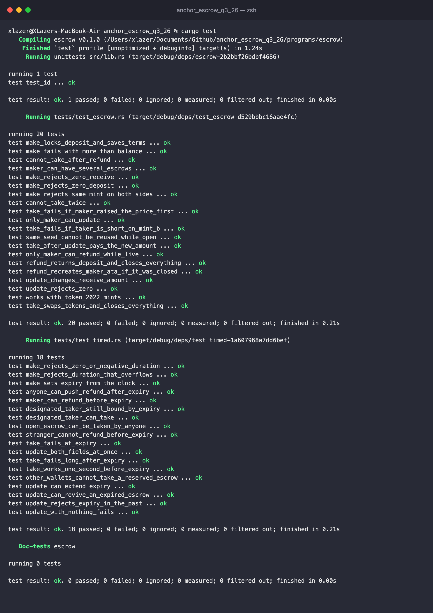

# anchor_escrow_q3_26

Token escrow on Solana, written with Anchor 1.1.2 for Turbine Q3.

A maker locks some amount of token A and names how much token B they want for it. A taker sends the token B and gets the token A in one transaction. The offer has an expiry, and can optionally be reserved for one specific taker.

Tests are in Rust and run on LiteSVM, no validator needed.

Program ID (local keypair, not deployed anywhere): `CX1gEY431CXgVKiWMLdo94QPN49BtKW7fPmrByFZrJ5p`

## Instructions

| Instruction | Signer | What it does |
|---|---|---|
| `make(seed, deposit, receive, duration, taker)` | maker | Creates the escrow account and its vault, moves `deposit` of mint A into the vault. The offer is live for `duration` seconds. `taker` is optional |
| `take(expected_receive)` | taker | Sends `receive` of mint B to the maker, sends the whole vault to the taker, closes the vault and the escrow |
| `refund()` | maker, or anyone once expired | Sends the vault back to the maker and closes both accounts |
| `update(new_receive, new_expires_at)` | maker | Changes the price, the expiry, or both. Pass `None` for whatever should stay the same |

Rent from the escrow and the vault always goes back to the maker, since they paid for both in `make`. If the maker or taker is missing an ATA for the token they're receiving, `take` and `refund` create it (paid by whoever signs).

## Accounts

- `escrow`: PDA at `["escrow", maker, seed.to_le_bytes()]`. Holds the maker, both mints, the `receive` amount, the optional taker, `expires_at` and the bump. The `seed` is just so one maker can have more than one escrow open.
- `vault`: the escrow PDA's associated token account for mint A. The escrow PDA signs for it in `take` and `refund`.

Everything goes through `token_interface`, so Token-2022 mints work too (there's a test for that).

## Timed escrow (task 4)

The time part is an expiry, and the condition is an optional designated taker (a signature check).

- `make` reads `Clock::unix_timestamp` and stores `expires_at = now + duration`. `duration` has to be positive.
- `take` only goes through while `now < expires_at`. If the escrow was made with `taker: Some(pubkey)`, the signer has to be that wallet, otherwise `WrongTaker`.
- `refund` works for the maker any time. Once `now >= expires_at`, anyone can call it. The tokens and rent still go to the maker, the caller only pays the fee. That way an expired offer doesn't sit there with funds locked until the maker comes back. A bot can clean it up, or the taker can.
- `update` can move `expires_at`. It has to be in the future. Setting it on an escrow that already expired opens it again, which is fine since it's the maker's deposit.

Take checks `now < expires_at` and the open refund checks `now >= expires_at`, so there's never a second where both work or neither does.

## Why `take` takes an amount

`update` lets the maker change the price whenever they want. If take just paid whatever `receive` was stored, a maker could raise it right before someone's take landed, and the taker would pay more than they agreed to. So the taker passes the `receive` they saw, and take fails with `ReceiveChanged` if it's different.

## Errors

| Code | Name | When |
|---|---|---|
| 6000 | `InvalidAmount` | deposit or receive is 0 |
| 6001 | `SameMint` | mint A and mint B are the same |
| 6002 | `ReceiveChanged` | `expected_receive` doesn't match the escrow |
| 6003 | `InvalidExpiry` | duration ≤ 0, overflow, or new expiry not in the future |
| 6004 | `EscrowExpired` | take after `expires_at` |
| 6005 | `NotExpired` | someone other than the maker tries to refund too early |
| 6006 | `WrongTaker` | escrow is reserved for a different wallet |
| 6007 | `NothingToUpdate` | update called with both fields `None` |

## Running it

Needs Rust 1.89 (pinned in `rust-toolchain.toml`), the Solana CLI and Anchor 1.1.2.

```bash
anchor build
cargo test
```

`Anchor.toml` asks for anchor 1.1.2. If `anchor --version` shows something else, run `avm use 1.1.2` or call `~/.avm/bin/anchor-1.1.2` directly.

On a fresh clone `anchor build` prints a "Program ID mismatch" warning. The program keypair lives in `target/deploy`, which is gitignored, so anchor makes a new one that doesn't match `declare_id!`. It still builds, and the tests load the program at the `declare_id!` address so they don't care. `anchor build --ignore-keys` skips the check.

The tests `include_bytes!` the program from `target/deploy/escrow.so`, so build before testing or they'll run against an old binary (or fail to compile on a fresh clone).

## Tests

38 tests across two files:

- `tests/test_escrow.rs`: make, take, refund and update. Checks balances and closed accounts after each, plus the failure cases: zero amounts, same mint, not enough balance, reusing a seed, taking twice, taking after a refund, someone else refunding or updating, the front-running check, and a full make + take with Token-2022 mints.
- `tests/test_timed.rs`: expiry is set from the clock, take one second before vs at expiry, stranger refund before vs after expiry (and that the funds still land with the maker), designated taker vs outsider, extending and reviving with update.

Time is moved with `svm.set_sysvar::<Clock>()`. Shared setup (mints, ATAs, instruction builders) is in `tests/common/mod.rs`.



## Layout

```
programs/escrow/
├── src/
│   ├── lib.rs
│   ├── constants.rs
│   ├── error.rs
│   ├── state.rs
│   └── instructions/
│       ├── make.rs
│       ├── take.rs
│       ├── refund.rs
│       └── update.rs
└── tests/
    ├── common/mod.rs
    ├── test_escrow.rs
    └── test_timed.rs
```
